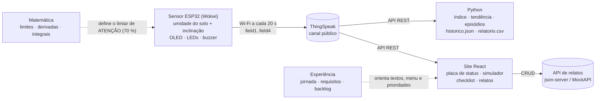
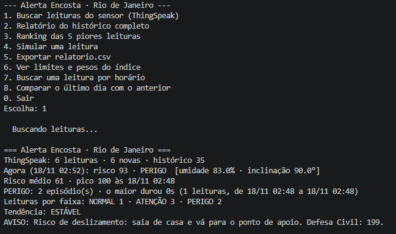

# Lógica · O Cérebro Conectado (Computational Thinking with Python)

Programa em Python que **busca no ThingSpeak** as leituras publicadas pelo ESP32 (umidade do solo e inclinação do terreno), calcula o **Índice de Risco de deslizamento**, percebe quando a situação **está piorando** e guarda um **histórico sem leituras repetidas**.

Quem usa: o **agente comunitário de Defesa Civil** (voluntário do NUDEC da comunidade), que acompanha a encosta e avisa os vizinhos.


> **CitizenTech da Minha Cidade** · FIAP Global Solution 2026.2 · Engenharia de Software, 1º ano · Rio de Janeiro. Este repositório é a parte **Lógica (Computational Thinking with Python)**. Cada disciplina tem a sua entrega; a Ficha abaixo é a mesma em todas.

## Ficha da CitizenTech

| | |
|---|---|
| **Nome da CitizenTech** | Alerta Encosta |
| **Cidade e bairro** | Rio de Janeiro · Morro do Borel, Tijuca (comunidade de referência dos depoimentos públicos usados na pesquisa) |
| **Cidadão beneficiado** | Morador de comunidade em encosta com risco de deslizamento, principalmente idosos e famílias que dormem em casa durante a chuva; e o agente comunitário de Defesa Civil (NUDEC) que avisa os vizinhos |
| **Problema, em uma frase** | Em noite de chuva forte, o morador de encosta não sabe se o barranco atrás da casa está no limite, e a sirene só considera a chuva da região, não o solo daquela encosta |
| **Como funciona** | Um ESP32 na encosta mede umidade do solo e inclinação do terreno, calcula um Índice de Risco (0 a 100) e acende verde / amarelo / vermelho. Os dados vão para o ThingSpeak; um programa em Python analisa a tendência e o histórico; um site mostra ao morador o que fazer e recebe relatos da comunidade |
| **O que cada parte faz** | **Sensor:** mede e reage sozinho · **Lógica:** busca os dados, calcula o risco, detecta "piorando" e guarda histórico · **Matemática:** calcula quanto tempo a família tem antes de o solo ficar crítico e define o limiar do alerta · **Interface + Interação:** site que mostra o risco, simula, orienta e registra relatos · **Experiência:** jornada do morador, requisitos e backlog · **Pitch:** vídeo de 3 min |
| **Repositórios** | Site (Front-end Design + Web Development): **TODO** link · Sensor (Edge Computing): **TODO** link · Lógica (Computational Thinking with Python): **TODO** link |
| **Indicador de impacto** | Minutos de antecedência entre o alerta de ATENÇÃO e o solo crítico (meta ≥ 60 min; o modelo dá 1h51) · % de moradores da área que confirmam ter recebido o alerta · relatos de risco resolvidos por mês |
| **ODS conectados** | **11** (meta 11.5: reduzir mortes e pessoas afetadas por desastres, protegendo os mais vulneráveis) · **13** (meta 13.1: resiliência a riscos climáticos; 13.3: alerta precoce e educação) · **10** (as áreas de risco concentram famílias de baixa renda) |

## Integrante

| Nome completo | RM | Turma |
|---|---|---|
| Victor Lopes Tavares da Fonseca | 571315 | 1ESSRA-2026 |

## Como as partes conversam



**Uma fórmula só, em três lugares.** O Índice de Risco é o mesmo no ESP32, no Python e no site. O morador vê a mesma faixa no OLED, no terminal do agente e no celular:

```
nivel = (valor - min) / (max - min) * 100          limitado entre 0 e 100
risco = 0,6 * nivel_umidade  +  0,4 * nivel_inclinacao
NORMAL < 40  ·  ATENÇÃO 40 a 70  ·  PERIGO >= 70
umidade do solo: 30 a 90 %      inclinação: 0 a 10°
```

---

## Como rodar

```bash
pip install -r requirements.txt      # só precisa da biblioteca requests
python main.py
```

> **Windows:** se `python` abrir a Microsoft Store, use o lançador `py`: `py -m pip install -r requirements.txt` e depois `py main.py`.

Sem configurar nada, o programa já funciona com o `backup.json` (dados **simulados** de uma noite de chuva, explicados abaixo).

### Ligar no canal da equipe

No topo do `main.py`, no dicionário `CONFIG`:

```python
"thingspeak": {
    "canal_id": "2712345",     # número do canal (ThingSpeak > Channel Settings)
    "chave_leitura": "",       # Read API Key, só se o canal for privado
    ...
```

Na primeira busca que der certo, o `backup.json` é substituído pelos dados reais do canal.

---

## Menu

| Opção | O que faz |
|---|---|
| 1 | Busca as últimas 30 leituras (ThingSpeak, ou backup sem rede), junta ao histórico e mostra o relatório |
| 2 | Relatório do histórico completo |
| 3 | Ranking das 5 piores leituras *(para ir além)* |
| 4 | Simular uma leitura digitando os valores (testa a fórmula sem sensor) |
| 5 | Exporta `relatorio.csv` |
| 6 | Mostra limites, pesos e faixas |
| 7 | Busca a leitura mais próxima de um horário, com **busca binária** no histórico ordenado *(para ir além)* |
| 8 | Compara o último dia do histórico com o anterior: risco médio, pico e leituras em PERIGO *(para ir além)* |
| 0 | Sair |

Os três itens "para ir além" do enunciado estão feitos: ranking (3), busca por horário (7) e hoje × ontem (8). A opção 8 precisa de leituras de dois dias diferentes. Com o `backup.json` (uma noite só), ela avisa isso; com o canal real rodando por mais de um dia, mostra a comparação.

## Print da execução

Com o canal real (18/11/2026): a opção 1 buscou no ThingSpeak as 6 leituras da demonstração no Wokwi e juntou ao histórico da noite simulada (29 + 6 = 35).



Com o `backup.json` da noite simulada (sem internet), o mesmo relatório mostra a tendência **PIORANDO**:

```text
=== Alerta Encosta · Rio de Janeiro ===
backup.json: 29 leituras · 29 novas · histórico 29 · 1 descartada(s) (campo vazio ou inválido)
Agora (03/11 21:50): risco 78 · PERIGO  [umidade 89.2% · inclinação 4.6°]
Risco médio 55 · pico 78 às 03/11 21:50
PERIGO: 2 episódio(s) · o maior durou 1h00 (7 leituras, de 03/11 19:10 a 03/11 20:10)
Leituras por faixa: NORMAL 7 · ATENÇÃO 13 · PERIGO 9
Tendência: PIORANDO (4 altas seguidas)
AVISO: Risco de deslizamento: saia de casa e vá para o ponto de apoio. Defesa Civil: 199.
AVISO: A situação está piorando: não espere a sirene para se preparar.
```

---

## O Índice de Risco

```
nivel = (valor - min) / (max - min) * 100        (limitado entre 0 e 100)
risco = 0,6 * nivel_umidade + 0,4 * nivel_inclinacao
```

| Medida | Campo | Mín. | Máx. | Peso | Por quê |
|---|---|---|---|---|---|
| Umidade do solo | field1 | 30 % | 90 % | **0,6** | A chuva que encharca o solo é o **gatilho** dos deslizamentos no Rio. Abaixo de ~30 % o solo está seco (nível 0); perto de 90 % está saturado (nível 100). Peso maior porque avisa **antes** de a terra se mexer. |
| Inclinação do terreno | field2 | 0° | 10° | **0,4** | A estaca com acelerômetro fica em pé (0°). Se ela tomba, a terra **já está se movendo**. 10° é um movimento grande e visível. O peso é menor porque a inclinação confirma o perigo, mas chega tarde para ser o único aviso. |

**Faixas:** NORMAL abaixo de 40 · ATENÇÃO de 40 a 70 · PERIGO a partir de 70.

O que isso significa na prática:

| Situação | Umidade | Inclinação | Risco | Faixa |
|---|---|---|---|---|
| Dia seco | 36 % | 0,3° | 7 | NORMAL |
| Chuva forte, solo encharcado | 80 % | 2° | 58 | ATENÇÃO |
| Solo saturado **e** terra se movendo | 90 % | 4° | 76 | PERIGO |
| Só solo saturado, sem movimento | 90 % | 0° | 60 | ATENÇÃO (alta) |

Os mesmos números estão no ESP32 (`sketch.ino`, no repositório do sensor) e no site (`src/domain/risco.js`, no repositório do site). Por isso o cidadão vê a mesma faixa no OLED, no terminal e no celular.

Configuração inválida (pesos que não somam 1, mínimo ≥ máximo, ATENÇÃO ≥ PERIGO) **dispara `ValueError`** em `validar_config()`, e o programa avisa e encerra antes de calcular qualquer coisa errada.

---

## Como o código está organizado

Cada função faz **uma tarefa**, tem **tipos** e **docstring**. No topo do arquivo, três apelidos de tipo deixam as assinaturas fáceis de ler:

```python
Config = dict[str, Any]   # o dicionário CONFIG (limites, pesos, avisos)
Feed = dict[str, Any]     # entrada crua do ThingSpeak: entry_id, created_at, field1...
Leitura = dict[str, Any]  # nossa leitura: {id, horario, medidas, risco, faixa}

def criar_leitura(feed: Feed, config: Config) -> Leitura | None: ...
```

| Bloco | Funções |
|---|---|
| Configuração | `validar_config` |
| Arquivos | `carregar_json`, `salvar_json` |
| API + plano B | `canal_configurado`, `buscar_feeds_thingspeak`, `salvar_backup`, `carregar_backup`, `obter_feeds` |
| Modelo | `converter_horario`, `ler_medidas`, `calcular_nivel`, `calcular_risco`, `classificar_faixa`, `criar_leitura`, `converter_feeds` |
| Memória | `leitura_valida`, `carregar_historico`, `mesclar_historico` (usa um **set** de horários: o `entry_id` recomeça do 1 quando o canal é limpo), `exportar_csv` |
| Análise | `contar_altas_finais`, `contar_quedas_finais`, `analisar_tendencia`, `encontrar_episodios`, `duracao_episodio`, `maior_episodio`, `contar_por_faixa`, `leitura_de_pico`, `risco_medio`, `piores_leituras` |
| Para ir além | `buscar_por_horario` (**busca binária**), `agrupar_por_dia`, `resumir_dia`, `comparar_dias` |
| Apresentação | `formatar_hora`, `formatar_dia`, `formatar_duracao`, `formatar_medidas`, `montar_relatorio`, `imprimir_linhas` |
| Entrada | `ler_texto`, `ler_numero`, `ler_horario` |
| Menu | `acao_*`, `mostrar_menu`, `main` |

### A busca binária, passo a passo

O histórico está em ordem de horário (o `mesclar_historico` ordena a cada busca). Para achar a leitura de 03/11 18:30 em 1.000 leituras, a busca olha a do **meio**: se ela é anterior a 18:30, a resposta está na metade da direita, e a da esquerda é descartada. Senão, descarta a da direita. Em 10 passos sobra uma leitura (2¹⁰ = 1.024). No fim, compara essa leitura com a anterior a ela e devolve a mais próxima. Uma busca simples, olhando uma por uma, faria até 1.000 comparações.

Cada leitura é um dicionário:

```python
{"id": 14, "horario": "2026-11-03T19:10:00-03:00",
 "medidas": {"umidade_solo": 88.7, "inclinacao": 3.36},
 "risco": 72.1, "faixa": "PERIGO"}
```

## O que não derruba o programa

| Falha | O que acontece |
|---|---|
| Sem internet / timeout / status ≠ 200 | `requests.RequestException` tratada → usa `backup.json` |
| Canal não configurado | Avisa e usa `backup.json` |
| `backup.json` ou `historico.json` ausente ou corrompido | Avisa e segue com lista vazia |
| Item do `historico.json` editado à mão ou com outras medidas | `leitura_valida` ignora o item e avisa quantos foram ignorados |
| Leitura com campo vazio (`null`), `entry_id` com texto ou data inválida | É descartada e contada no relatório |
| Horário digitado no formato errado (opção 7) | Mostra o formato certo e pede de novo |
| CSV aberto no Excel (sem permissão) | Avisa, não quebra |
| Letras, vazio ou número fora do intervalo no teclado | Pede de novo |
| Ctrl+C / Ctrl+D | Sai com mensagem |

## Arquivos

| Arquivo | O que é |
|---|---|
| `main.py` | O programa |
| `backup.json` | Última busca boa do ThingSpeak. **Vem com dados simulados** pela equipe (noite de chuva hipotética, 1 leitura a cada 10 min, com uma leitura de campo vazio de propósito) até a primeira busca real |
| `historico.json` | Criado pelo programa: todas as leituras já vistas, sem repetir |
| `relatorio.csv` | Criado pela opção 5: `id,horario,umidade_solo,inclinacao,risco,faixa` |

## Integração com as outras partes

- **Sensor (Edge):** lê `field1` (umidade) e `field2` (inclinação), que o ESP32 publica a cada 20 s.
- **Interface/Interação (web):** usa a mesma fórmula, faixas, cores e textos; o `relatorio.csv` e o `historico.json` podem alimentar a página.
- **Experiência:** o menu e os avisos seguem a jornada do agente comunitário (relatório de Software & Total Experience Design, entregue no Teams).
- **Pitch:** a opção 1 buscando dados ao vivo entra no vídeo como prova.

## IA

Os prompts usados estão em [`prompts.md`](prompts.md). Regra da disciplina: **código que a equipe não sabe explicar não pontua**. Leiam cada função antes da entrega.
